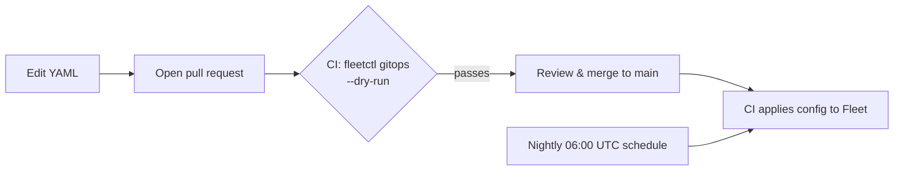

# Fleet GitOps: Device Management as Code

Endpoint configuration for a [Fleet](https://fleetdm.com) device-management lab, managed entirely through git. macOS update enforcement, compliance policies, software deployment, scripts, and device labels are all declared in YAML. CI applies them to Fleet, so every change is reviewed, versioned, and easy to roll back.

Built in an instructor-led Fleet lab as hands-on training for the **Fleet Certified GitOps Administrator** certification.

## How changes ship



- **Pull requests** run a dry run, so a broken config fails in review instead of in production.
- **Merges to `main`** apply the configuration to Fleet.
- **The nightly scheduled run** re-applies `main` to undo any drift from changes made by hand in the Fleet UI.
- **Credentials** (`FLEET_URL`, `FLEET_API_TOKEN`) live only in CI secrets. The workflow's `GITHUB_TOKEN` is limited to read-only.

The same pipeline is defined for GitHub Actions (`.github/workflows/workflow.yml`) and GitLab CI (`.gitlab-ci.yml`).

## What's managed

| Area | Config | What it does |
|---|---|---|
| OS updates | `fleets/workstations.yml` | Enforces a minimum macOS version with an update deadline |
| Policies | `platforms/macos/policies/` | Checks that all software updates are installed and that the approved DNS resolvers are in use |
| Scripts | `platforms/macos/scripts/` | Sets DNS resolvers on every network interface; verifies the Zoom install |
| Software | `platforms/macos/software/zoom.yml` | Deploys Zoom via self-service and during device setup, with a post-install check |
| Enrollment | `platforms/macos/enrollment-profiles/` | Supervised, non-removable automated enrollment profile |
| Labels | `labels/`, `global-labels.yml` | Groups hosts by architecture, OS family, IdP department, and uptime for scoping |
| Fleets | `fleets/` | Separate fleets for company workstations and personal mobile devices |

## Repository layout

```
default.yml             # Org-wide settings and global labels
fleets/                 # Per-fleet controls, policies, software
labels/                 # Reusable host labels
platforms/<os>/         # Profiles, policies, scripts, software per platform
.github/                # GitHub Actions workflow + fleet-gitops action
.gitlab-ci.yml          # Equivalent GitLab pipeline
```

## Setup

1. Install `fleetctl` ([docs](https://fleetdm.com/guides/fleetctl#installing-fleetctl)).
2. Add `FLEET_URL` and `FLEET_API_TOKEN` as repository secrets (GitHub) or CI/CD variables (GitLab). Use an API-only user for the token.
3. Enable the **Apply latest configuration to Fleet** workflow and run it once by hand.

Format reference: [Fleet YAML files](https://fleetdm.com/docs/configuration/yaml-files).
